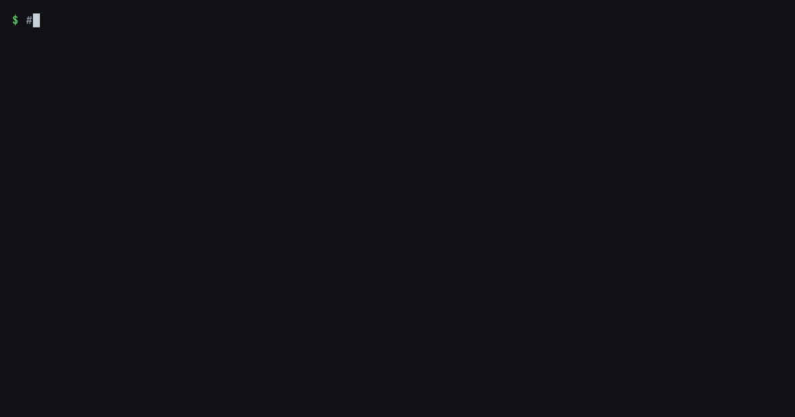
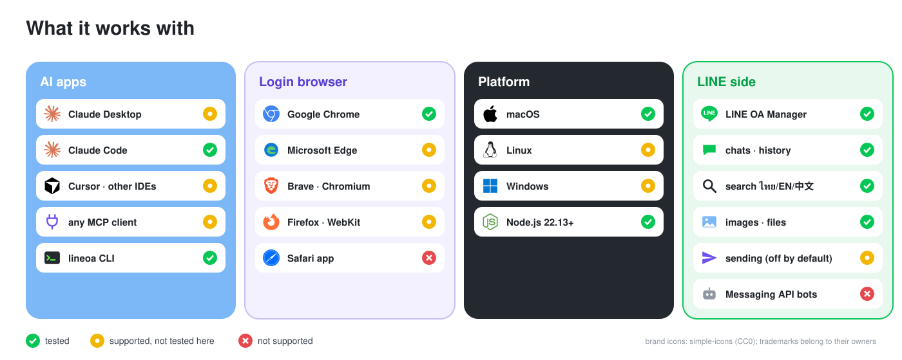
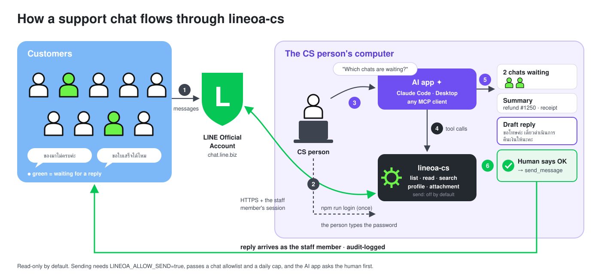
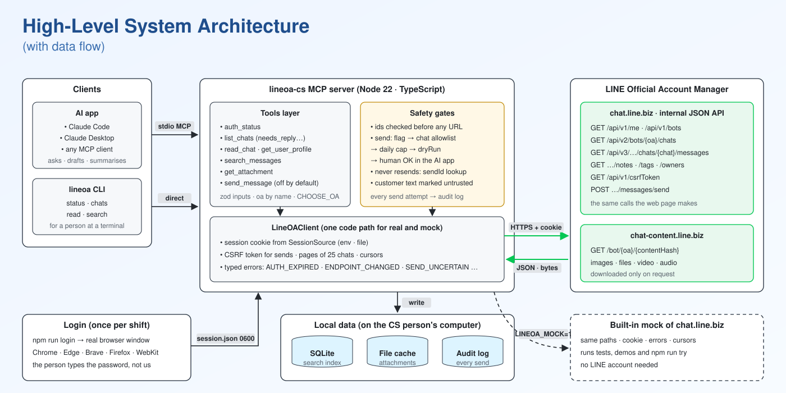
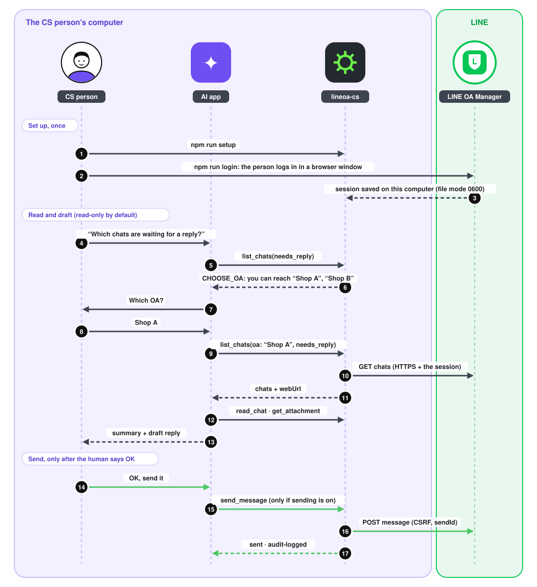

# lineoa-cs

**ภาษาไทย:** [เริ่มใช้งาน (สำหรับทีม CS)](docs/START.th.md) · [คู่มือการใช้](docs/USAGE.th.md)

[](https://github.com/Jamamaboy/lineoa-cs-mcp/releases)
[](https://github.com/Jamamaboy/lineoa-cs-mcp/actions/workflows/ci.yml)


Ask your AI app, in plain words, which LINE chats are waiting for a reply, what a customer wrote, or who
mentioned a refund. You get a summary and a drafted reply back. Sending is off by default; when it is on, the AI app asks you before each send (unless you choose "Always allow", which you shouldn't).

Technically, this is an MCP server that lets an AI agent work a LINE Official Account the way a
customer-support person does. It can list ongoing chats, read a chat, search messages across chats, send a message, see a customer's profile,
and open the images and files customers send.

It works through the same web console a CS person uses (LINE OA Manager, `chat.line.biz`), with that person's
own login. LINE's Messaging API is built for bots: it can't see existing chats or history, and it can't search.

**Read-only by default.** Sending is off until you turn it on.



<p align="center"></p>

## How it flows

<p align="center"></p>

## Architecture

<p align="center"></p>

## How it is used

<p align="center"></p>

## What it unblocks

| without it | with lineoa-cs |
|---|---|
| a CS person scrolls the chat list to find who is waiting | "which chats are waiting for a reply?" → `list_chats(needs_reply)` |
| "has anyone else reported this?" means opening chats one by one | `search_messages` finds Thai or English text across recent chats, with context |
| a payment slip or bug screenshot has to be opened by hand | `get_attachment` shows the image to the AI, which can read it |
| the AI drafts a reply in one window and someone pastes it in another | `send_message` sends it as the staff member, after a dry run and the human's OK |
| the AI can't hand a chat back | every result has a `webUrl` that opens that chat in LINE OA Manager |

## Setup

You need Node 22.13 or newer, Google Chrome, Microsoft Edge or another supported browser (Brave, Chromium, Firefox, WebKit), and an account that can open LINE OA Manager.

```bash
git clone https://github.com/Jamamaboy/lineoa-cs-mcp.git
cd lineoa-cs-mcp
npm install
npm run setup      # adds the server to Claude Desktop and Claude Code (read-only)
npm run login      # a browser window opens; log in to LINE yourself
```

Restart Claude Desktop, or run `claude`, and ask: *"Which LINE chats are waiting for a reply?"*

In this folder, Claude Code greets you with the next step and example questions. `npm run features` opens
[`docs/features.html`](docs/features.html): what each tool does, and every feature with its commits.

**Not a developer?** On a Mac, follow [`docs/START.th.md`](docs/START.th.md) (Thai), or double-click
`start-mac.command`: it checks Node, installs, runs `npm run setup` and asks before it opens the login.

**No LINE account?** Try everything against the built-in mock:

```bash
npm run setup -- --mock   # registers only lineoa-cs-mock (sample data, sending on, never reaches LINE)
npm run try        # a 10-second tour in the terminal, no AI app needed
claude             # in this folder: approve "lineoa-cs-mock" from .mcp.json, then ask questions
                   # (sending is on for the mock only, so you can try send_message safely)
npm run mock       # browse the mock's chats at http://127.0.0.1:8787
LINEOA_MOCK=1 npm run lineoa -- chats --oa "Demo Shop"   # the terminal command, on the mock
```

<details>
<summary>settings (environment variables)</summary>

| variable | default | meaning |
|---|---|---|
| `LINEOA_ALLOW_SEND` | `false` | `true` registers `send_message`. Off means the AI can't even see the tool. |
| `LINEOA_SEND_CHAT_ALLOWLIST` | empty | only these chat ids may receive messages |
| `LINEOA_SEND_DAILY_LIMIT` | `50` | sends per day before the tool refuses |
| `LINEOA_BOT_ALLOWLIST` | empty | only these OAs are reachable |
| `LINEOA_DEFAULT_OA` | empty | OA to use when a request names none (name, @id or botId). Without it, an account with several OAs makes the AI ask which one. |
| `LINEOA_MOCK` | unset | `1` runs the built-in mock instead of LINE (MCP server and terminal command) |
| `LINEOA_SESSION_FILE` | `~/.config/lineoa-mcp/session.json` | written by `npm run login` |
| `LINEOA_INDEX_FILE` | `~/.local/share/lineoa-mcp/index.db` | local search index |
| `LINEOA_CACHE_DIR` | `~/.cache/lineoa-mcp/attachments` | downloaded files |
| `LINEOA_MAX_ATTACHMENT_MB` | `32` | bigger files are refused |
| `LINEOA_SYNC_MAX_CHATS` / `_MESSAGES` | `50` / `200` | how much search copies per refresh |

</details>

## Tools

| tool | does | changes anything? |
|---|---|---|
| `auth_status` | who is logged in, which OAs they can reach, whether sending is on | no |
| `list_chats` | chats, newest first; filters `ongoing`, `unread`, `needs_reply`, `all` | no |
| `read_chat` | a chat's messages, oldest to newest; attachments as metadata | no, never marks read |
| `search_messages` | substring search (works for Thai) across recent chats, with context | no |
| `get_user_profile` | name, friend status, staff tags, notes, assignee | no |
| `get_attachment` | an image shown to the AI, or a file saved locally | no |
| `send_message` | sends text as the staff member; `dryRun` previews | **yes**, only if `LINEOA_ALLOW_SEND=true` |

The same features are in a terminal command: `npm run lineoa -- status | chats --needs-reply | read <chatId or exact customer name> | search <text>`.
`read "customer name"` opens a chat only on an exact name match (and prints `→ name (id)` first); a partial name only
suggests "Did you mean …?". It looks at the latest 125 chats. Dates print like `5 Nov 2026, 12:00`.

**Several OAs?** Every tool takes `oa` (a name like `"Shop A"`, an `@id` or a botId). If the account reaches more
than one OA and the request doesn't say which, the tool answers `CHOOSE_OA` with the list, and the AI asks you.

## How it works

The picture is in [Architecture](#architecture). In words:

- **One client for real and mock.** The mock copies the console's paths, cookie, error bodies and cursors,
  so `LineOAClient` is the same code for both, and the e2e tests drive a real MCP client against it.
- **Calls the console's JSON API instead of clicking the page.** The endpoints came from reading six
  open-source projects. They were then checked against a live OA: me, bots, chats, chat detail, messages,
  notes, tags, owners and attachment content.
- **Search** is local because the console has no message-search endpoint. Before each search, new messages
  from recent chats are copied into SQLite (Node's built-in one, so nothing native to install). A substring
  match works for Thai, which has no spaces between words.

## Authentication

- **A person logs in; the server only holds the session.** `npm run login` opens Chrome, Edge, Brave,
  Chromium, Firefox or WebKit. The CS person logs in there themselves, including email, QR or 2FA. The server
  never sees a password.
- When the console answers `/api/v1/me`, only the `*.line.biz` cookies are saved, to a file only that user can
  read (mode 0600, outside the repo).
- Every request sends the cookie and the console's client-version header. A 401, or a redirect to the login
  page, becomes `AUTH_EXPIRED: … run npm run login`. The server never logs in again by itself.
- Sending also fetches the console's CSRF token, and refreshes it once on a 403.
- **Extensible:** the cookie comes from a `SessionSource` (environment or file today). A web login page, a
  browser extension or a team vault would each be one new source ([CONTRIBUTING.md](CONTRIBUTING.md)).

## Attachments

- `read_chat` returns metadata only: kind, file name, size, expiry. A chat full of photos stays cheap for the
  model.
- `get_attachment` downloads on request, from `chat-content.line.biz` with the session cookie, or from the
  sender's public URL with no cookie at all.
  - Expired files and files over 32 MB are refused with typed errors.
  - The type is read from the file's first bytes, not its name.
  - Files are saved by content hash: written to a temp name, renamed when complete, mode 0600.
- **Images** are rotated, shrunk to at most 1568 px, and returned as MCP image content, so a vision model can
  read a slip or a screenshot. Larger results are only saved. **Other files** (PDF, Excel, video) return a
  local path and, for plain text, a preview.

## Safety

- **Sending has five layers.**
  - The tool doesn't exist unless `LINEOA_ALLOW_SEND=true`.
  - An optional chat allowlist limits who can receive messages.
  - A daily cap stops runaway sends.
  - `dryRun` previews a message without sending it.
  - `destructiveHint` makes AI apps ask the human first.
- A send whose result is unknown is never retried. The server looks its `sendId` up in the chat and returns
  `SEND_UNCERTAIN` if it isn't there.
- Every send attempt goes to an audit log. The log stores the text's length and hash, not the text.
- Customer messages and files are marked as untrusted input in every tool description.
- Reading never marks a chat as read, so customers don't see "read" when nobody has answered.

## Assumptions

The brief leaves these open; this is what the code assumes (full list with reasons in [`docs/PLAN.md`](docs/PLAN.md) §2).

- **One server process = one CS staff member's session.** That session may reach several OAs; with more than
  one and no `LINEOA_DEFAULT_OA`, tools answer `CHOOSE_OA` so the AI asks which one.
- **"Ongoing chat" = not marked done in the console**, newest first. `needs_reply` = ongoing and the customer
  spoke last; `unread` and `all` are also offered.
- **"Search across all chats" = a substring match over recent history**, because the console has no
  message-search endpoint: the 50 most recent chats and 200 messages each are copied into a local index first.
- **"Send a message" = a text message.** Sending files is not built.
- **The server runs next to the CS person** (stdio, started by their AI app), not as a hosted service.
- **Sends go out as the logged-in staff member**, so a person stays accountable: sending is off by default, the AI
  app asks first, and every attempt is audit-logged.
- **Reading never marks a chat as read**; customers don't see "read" when nobody has answered.
- **The server holds no LLM key.** Summaries, drafts and translation are done by the AI app.
- During development the live OA was used **read-only** (no sends, no opening unread chats); sending was tested
  on the mock.

## Stack and why

| Choice | Why |
|---|---|
| TypeScript on Node 22.13+ | The MCP SDK is TypeScript-first; one language for the server, the mock and the tests; Node 22 has SQLite built in. |
| `@modelcontextprotocol/sdk` + zod, stdio | The official SDK; zod schemas are the tool inputs and validate LINE's responses; stdio works with Claude Code and Desktop with no network auth. |
| `fetch` against the console's JSON API | Fast and deterministic. Driving the page with a browser for every action would be slow and brittle. |
| `playwright-core` for login only | Opens the browser already installed (Chrome, Edge, …) so the person logs in themselves; no browser download. |
| `node:sqlite` with substring search | No native module to build, and a substring match works for Thai and Chinese, which have no spaces between words. |
| `sharp` | Shrinks images before they reach the AI: cheaper and within image limits. |
| Hono mock on 127.0.0.1 | A small HTTP server that copies the console's paths, cookies and errors, so tests and demos need no LINE account. |
| vitest, Biome | Fast tests (a real MCP client against the mock) and one tool for lint and format. |

## Limitations and trade-offs

- **Unofficial API.** chat.line.biz's internal API is undocumented and can change. Endpoints live in one
  module, a changed response becomes `ENDPOINT_CHANGED` instead of a fake success, and the mock plus e2e
  tests show quickly what broke. Driving the page with a browser is the fallback, but it is slower and more
  brittle, so it isn't built.
- **Terms of service.** Automating a staff session is a grey area. This tool uses the person's own seat, a
  human login, low request volume and an audit log. A production rollout should be cleared with LINE or
  legal first.
- **Windows.** The session file relies on the user-profile folder permissions, because mode 0600 has no effect
  there. CI checks the build and tests on Windows; setup and login are not tested there.
- **Sessions expire**, usually within a day, so the CS person logs in again.
- **Search freshness.** Search only sees what was copied: the 50 most recent chats and 200 messages each by
  default.
- **Bot replies can be invisible.** If an OA also runs a bot through the Messaging API, the bot's replies may
  not appear in the console's history. `needs_reply` then lists chats that a bot already answered. On a live
  OA this showed up as customers who had typed a code that a bot handled.
- **Not built yet** (out of the MVP scope; each needs a test OA or design work first): sending files, mark as read, a hosted multi-user server, and realtime updates (the
  console has an SSE stream).
- **Live checks.** All read paths were verified against a live OA, read-only. Sending was verified on the
  mock only. A live send needs a test OA and a test chat.

## What it could grow into

These ideas came out of the research and real support-OA chats. They are planned, not built:

- **Case layer.** One chat holds many support cases. Rich-menu buttons open a case; the AI suggests tags (type,
  area, severity) and a CS person confirms; status runs open → waiting → resolved, and only a human resolves.
- **Records and analytics.** Weekly counts by area and type, first-response time, and chats that went quiet
  after "resolved".
- **One customer across OAs.** Link a reporter in the support OA to the same person in the product OA by a verified email, so CS sees
  what the customer did right before reporting. Personal data stays in the server, and the AI only sees masked
  references.
- **Images as evidence.** Collect slips and screenshots per case, with an expiry so personal data isn't kept
  forever.
- **Reach the agent from chat apps**, for example a supervisor approving a send from Telegram through Claude
  Code Channels.

## Develop

```bash
npm run check      # lint + typecheck + tests (CI runs the same)
npm run try        # tour against the mock
```

To add a tool, another backend or a new way to log in, see [CONTRIBUTING.md](CONTRIBUTING.md).

## How this was built

This was built with coding agents (Claude Code), working in three lanes: plan, research and dev. The process
is in the repo:

- The plan is in [`docs/PLAN.md`](docs/PLAN.md), with a Thai version with diagrams in
  [`docs/PLAN.html`](docs/PLAN.html).
- The research compared 34 similar projects:
  [`docs/research/refs-comparison.html`](docs/research/refs-comparison.html).
- Each lane keeps a log in `docs/<lane>/LOG.md`.
- Each feature is a branch of small commits, each one green on its own, merged with `--no-ff`. Read the
  history one level at a time:

  ```bash
  git log --first-parent --oneline main   # one commit per release
  git log --first-parent --oneline dev    # one merge per feature (or plan/research round)
  git log --oneline <merge>^1..<merge>^2  # the small commits inside one feature
  ```

[`docs/README.md`](docs/README.md) maps every document. A Thai user guide is in [`docs/USAGE.th.md`](docs/USAGE.th.md).

## Versions

| version | date | highlights |
|---|---|---|
| [v0.2.2](https://github.com/Jamamaboy/lineoa-cs-mcp/releases/tag/v0.2.2) | 2026-11-06 | README assumptions and stack choices; no stale references |
| [v0.2.1](https://github.com/Jamamaboy/lineoa-cs-mcp/releases/tag/v0.2.1) | 2026-11-06 | CI green on Windows (LF line endings) |
| [v0.2.0](https://github.com/Jamamaboy/lineoa-cs-mcp/releases/tag/v0.2.0) | 2026-11-06 | review fixes: CS start page, setup --mock, read by name, clearer errors, response checks, 78 tests |
| [v0.1.5](https://github.com/Jamamaboy/lineoa-cs-mcp/releases/tag/v0.1.5) | 2026-11-06 | welcome in Claude Code, features page, readable step-by-step diagram |
| [v0.1.4](https://github.com/Jamamaboy/lineoa-cs-mcp/releases/tag/v0.1.4) | 2026-11-06 | fresh-clone fixes: CLI hints, mock for the CLI, send on the mock |
| [v0.1.3](https://github.com/Jamamaboy/lineoa-cs-mcp/releases/tag/v0.1.3) | 2026-11-06 | docs: diagrams, graphics, demo GIF, history guide |
| [v0.1.1](https://github.com/Jamamaboy/lineoa-cs-mcp/releases/tag/v0.1.1) | 2026-11-06 | security and reliability fixes from a code review |
| [v0.1.0](https://github.com/Jamamaboy/lineoa-cs-mcp/releases/tag/v0.1.0) | 2026-11-06 | first release: 7 tools, login, CLI, setup, mock |

Details are in [CHANGELOG.md](CHANGELOG.md).
